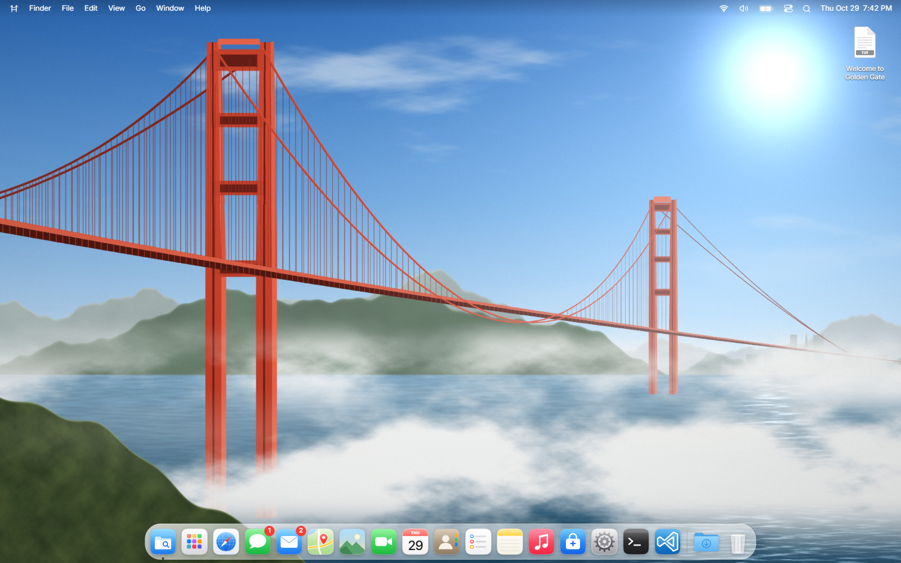
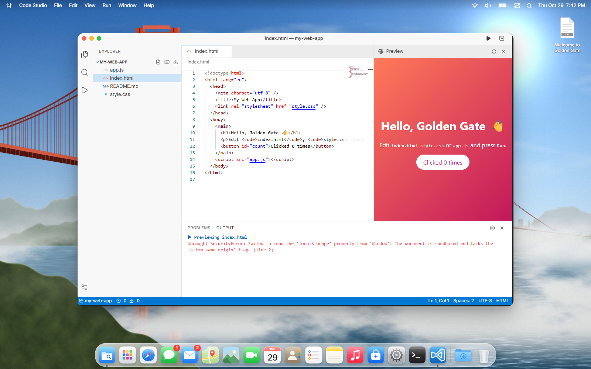
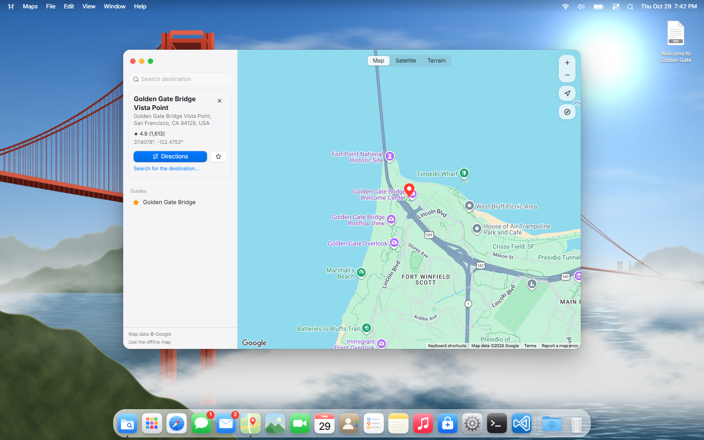
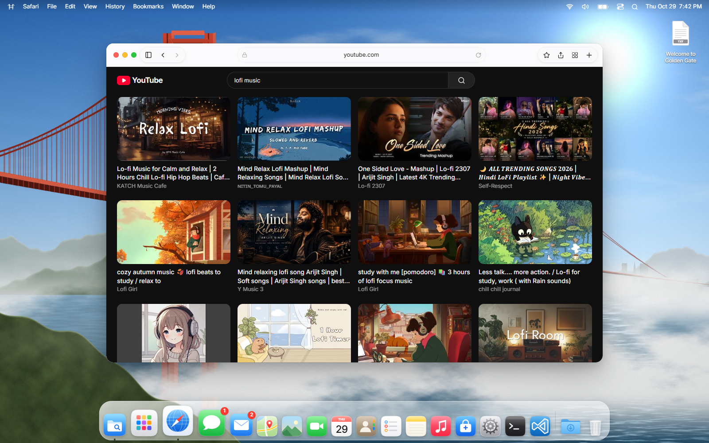
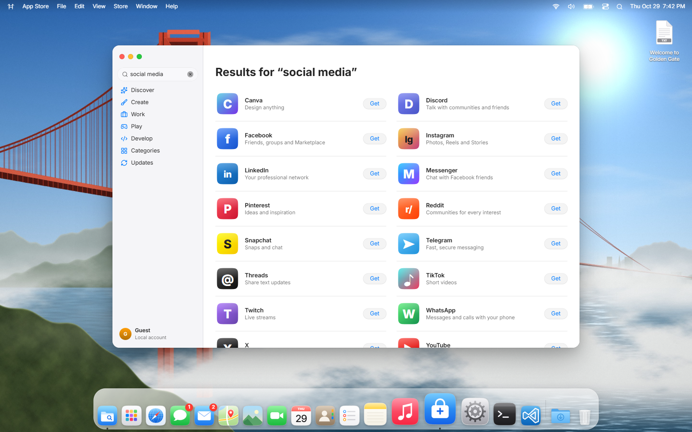

<div align="center">

# 🌉 Golden Gate — a macOS‑style desktop that runs in your browser

**Try a Mac‑like desktop from Windows, Linux or a Chromebook. No install, no account.**

[**▶ Live demo — golden-gate-os-gb29.web.app**](https://golden-gate-os-gb29.web.app)




</div>

Golden Gate is a **browser‑based desktop simulator** inspired by a modern Mac. It has windows, a Dock, a menu bar, Spotlight, Control Center and more than 40 working apps, built entirely in TypeScript. Everything runs inside a browser tab. Your files stay in the browser's own storage (IndexedDB), and nothing on your real computer changes unless you choose a file or folder to bring in.

> It is an independent, open-source project and is **not affiliated with or endorsed by Apple**. No Apple artwork, wallpapers, icons or sounds are included. The wallpapers are rendered procedurally, the icons are hand-written SVG, and the sounds are synthesised with Web Audio.

---

## ✨ Highlights

| | |
|---|---|
| 🧑‍💻 **Code Studio** | A VS Code‑style editor built on Monaco, the editor component inside VS Code. It has an explorer, tabs, IntelliSense, live TypeScript errors, quick open (⌘P), project search, and Run (⌘R / F5) for JS and TS. Web projects get a live preview. You can create projects from templates, open real folders from your computer and download projects as ZIP. |
| 🗺️ **Maps on Google Maps** | An interactive Google map with Places search, place details (rating, opening hours, phone, website), and turn-by-turn directions for driving with live traffic, walking, cycling and transit, via the Routes API. It shows your precise location with its real accuracy radius and falls back to an offline vector map. |
| 🧭 **Safari** | Tabs, a Tab Overview, Reopen Closed Tab, history, bookmarks and a Reading List. **YouTube search and playback** use the official embedded player. Sites that allow embedding load inside the window; the rest open in a new tab. |
| 🛍️ **App Store with 40+ web apps** | Search “social media” to find Instagram, WhatsApp, LinkedIn, X, Reddit, TikTok, Discord and more. Installing one adds it to Launchpad; opening it launches the real service in its own window, signed in with your own account. VS Code for the Web, GitHub, ChatGPT, Claude, Notion, Figma and Spotify are there too. |
| 🪟 **Real window manager** | Drag, resize from every edge, zoom, full screen, edge-snap tiling, a genie minimise, ⌘‑Tab app switcher, Hide/Show, and the macOS app lifecycle, where an app keeps running until you quit it. |
| ⚡ **Smooth by design** | Animations run on GSAP and touch only transform and opacity, so they stay on the GPU compositor. App code preloads while the browser is idle, and the Dock avoids forced layouts. Steady frames hold 60 fps on an integrated GPU. |
| 📂 **Your files, with permission** | Finder can import files or whole folders from your computer after asking first, using the File System Access API. Real ZIP archives, Quick Look, tags and screenshots saved to the Desktop. |
| 📶 **Honest system info** | Wi‑Fi status, link type and bandwidth come from your browser. Battery uses the Battery Status API. About This Mac shows only what the browser reports, and anything it doesn't is labelled. |

<table>
<tr>
<td></td>
<td></td>
</tr>
<tr>
<td align="center"><b>Code Studio</b> — Monaco editor, explorer and live preview</td>
<td align="center"><b>Maps</b> — Google Maps, Places and directions</td>
</tr>
<tr>
<td></td>
<td></td>
</tr>
<tr>
<td align="center"><b>Safari</b> — YouTube search and playback</td>
<td align="center"><b>App Store</b> — social and web apps</td>
</tr>
</table>

## 📦 What's inside

**Desktop shell:** boot chime, first-run setup, login and lock screens (optional passcode, SHA‑256 + salt), sleep, restart and shut down, screen saver, hot corners. Also a menu bar with per-app menus, Control Center, Notification Center with widgets, Spotlight (apps, files, settings, maths and App Store results) and Launchpad. The Dock has magnification, launch bounce, running indicators, drag-to-reorder, minimised windows, a Downloads stack and Trash.

**Apps (40+ built in, plus 40 web apps):** Finder, Safari, Code Studio, Maps, Messages, Mail, Photos, FaceTime (your own camera), Calendar (natural-language quick add), Contacts (vCard), Reminders, Notes, Music, App Store and System Settings (30 panes). Also Terminal (a zsh-style shell over the virtual disk, with pipes, redirection and tab completion), Activity Monitor, TextEdit, Preview (images and PDFs), Calculator, Clock and Weather (live Open-Meteo). Podcasts, TV, Voice Memos, Font Book, Sketchbook, Codepad, Archive Utility (real ZIP), Chess, Mines, Photo Booth and Stickies round it out.

## 🚀 Quick start

```bash
git clone https://github.com/gurasees830/Golden-Gate-Mac-Os-27-experience.git
cd Golden-Gate-Mac-Os-27-experience/frontend
npm install
npm run dev          # http://localhost:5173
```

Production build: `npm run build`. The output goes to `frontend/dist` with relative paths, so any static host works. `npm run preview` serves the production build locally; it is much faster than the dev server.

### Optional API keys

Create `frontend/.env.local`. It's git-ignored; keys only ever go there.

```bash
VITE_YOUTUBE_API_KEY=...        # YouTube Data API v3: search YouTube inside Safari
VITE_GOOGLE_MAPS_API_KEY=...    # Maps JavaScript, Places (New), Routes and Geocoding APIs
```

Without keys everything still works: Safari plays pasted YouTube links, and Maps uses its offline map. Keys built into the frontend are visible to visitors, so **restrict them** in Google Cloud Console: limit each key to its APIs and to your site's address.

### Deploy to Firebase Hosting

```bash
cd frontend
npm run build
firebase deploy --only hosting   # uses frontend/firebase.json and .firebaserc
```

### Full stack (optional accounts and sync)

```bash
cp infrastructure/.env.example infrastructure/.env      # set a real POSTGRES_PASSWORD
docker compose -f infrastructure/docker-compose.yml --env-file infrastructure/.env up --build
# open http://localhost:8081
```

The desktop works fully without the backend; the API only adds accounts and preference sync.

## ⌨️ Keyboard shortcuts

On a Mac, shortcuts use ⌘. On Windows and Linux, ⌘ maps to **Ctrl** and ⌥ to **Alt**.

| Action | Mac | Windows / Linux | Works anywhere |
|---|---|---|---|
| Spotlight | ⌘Space | Ctrl+Space | Ctrl+K |
| App Switcher | ⌘Tab | Alt+Tab (full screen) | Alt+` |
| Close window / tab | ⌘W | Ctrl+W (full screen) | Alt+W |
| Quit app | ⌘Q | Ctrl+Q | Alt+Q |
| Safari: next / previous tab | ⌃Tab · ⇧⌘] / ⇧⌘[ | Ctrl+Tab (full screen) | Alt+] / Alt+[ |
| Safari: tab 1–9 | ⌘1…⌘9 | Ctrl+1…9 (full screen) | Alt+1…9 |
| Safari: Tab Overview / reopen tab | ⇧⌘\ · ⇧⌘T | Ctrl+Shift+\ · Ctrl+Shift+T | Alt+\ |
| Code Studio: quick open / run | ⌘P · ⌘R / F5 | Ctrl+P · Ctrl+R / F5 | — |
| Screenshot | ⇧⌘3 / ⇧⌘4 | Ctrl+Shift+3 / 4 | — |
| All shortcuts | ⌘/ | Ctrl+/ | Help menu |

Browsers keep some keys for themselves (Ctrl+Tab, Ctrl+W, Alt+Tab…). For the most realistic experience, turn on **Full Screen in Control Center**. Chromium browsers then use the Keyboard Lock API, so those keys reach Golden Gate instead of your browser. Trackpad swipe‑back and pinch‑zoom are blocked so they don't navigate away from the desktop.

## 🏗️ Architecture

```
frontend/        React 19 + TypeScript (strict) + Vite 8 + Tailwind CSS 4 + GSAP + Zustand + Dexie
  src/shell/     desktop, menu bar, Dock, window manager, overlays, Spotlight, Launchpad, app switcher
  src/apps/      one folder per app, lazy-loaded and registered in src/apps/index.ts
    code/        Code Studio (Monaco + language workers, templates, run/preview)
    maps/        Google Maps view, Places / Routes / Geocoding clients, offline map
    webapps/     App Store catalogue of real web services
  src/stores/    Zustand stores persisted to IndexedDB (settings, windows, apps, file system, data)
  src/lib/       network status, host-input guards, file access, shell interpreter, sounds, ZIP…
  src/tests/     Vitest + Testing Library unit tests
  e2e/           Playwright end-to-end tests
backend/         Spring Boot 3 (Java 21): accounts, sessions, CSRF, preference sync, Flyway, OpenAPI
infrastructure/  docker-compose for nginx + API + PostgreSQL
tools/           procedural wallpaper renderer (numpy + Pillow)
docs/            status report, known limitations and screenshots
```

**Performance notes:** each app is its own lazy chunk, and all chunks are fetched one by one during browser idle time after boot, so first launches don't wait on the network. The heavy Monaco and TypeScript workers load only when Code Studio opens. Window animations never animate blur, clip-path or layout.

## 🧪 Testing

```bash
cd frontend
npm test              # Vitest unit tests: calculator, shell, date parser, virtual FS, window lifecycle, UI
npm run test:e2e      # Playwright against a production build
cd ../backend
mvn test              # JUnit + MockMvc: CSRF, register/login/logout, lockout, preferences validation
```

## 🔒 Privacy

- No tracking or analytics.
- Files, settings and history live only in your browser's IndexedDB. Export them any time with Settings ▸ Time Machine.
- Location, camera, microphone and computer files are used only after you allow them, both in Golden Gate and in your browser.
- Web apps open the real services in their own windows. Golden Gate never sees your passwords.

## ⚠️ Honest limits

A web page can't install or run native programs, read your Wi‑Fi network's name, or browse your whole drive. Golden Gate says so where it matters instead of faking it. Read more in [`docs/STATUS.md`](docs/STATUS.md).

## 🤝 Contributing

Issues and pull requests are welcome. Good first contributions: a new app in `src/apps/`, a web app in `src/apps/webapps/catalog.ts`, a System Settings pane, or tests. Run `npx tsc -b && npm test` before opening a PR.

## 📄 License

[MIT](LICENSE). Product names such as macOS, Safari, Finder, Visual Studio Code, Instagram and WhatsApp belong to their owners and are used descriptively only.
